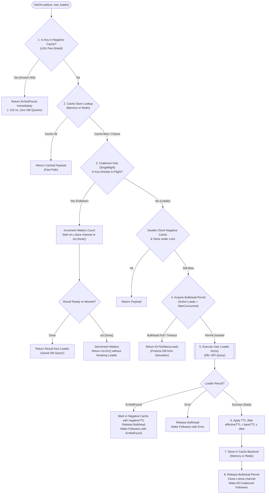

# GoCacheShield

[](https://golang.org)
[](LICENSE)
[](#supported-ecosystems)
[](#core-design-principles)
[](#verified-performance-benchmarks)
[](#5-remote-cache-outage-fallback-bulkhead)

> **Production-Grade Smart Cache Resilience & Concurrency Protection Engine across Go, Node.js, NestJS, PHP, and Laravel.**  
> Defends infrastructure against Cache Stampedes (Thundering Herd), Cache Avalanches, Penetration Attacks, Distinct-Key Bursts, and Remote Cache Outages.

---

> [!TIP]
> **Looking for installation, framework setup, and configuration?**
> Detailed step-by-step setup guides, code examples for Go, Node.js/Express, NestJS, and PHP/Laravel, plus production deployment instructions can be found in **[PROJECT-SETUP.md](PROJECT-SETUP.md)**.

---

## 📑 Table of Contents
1. [Overview & Problem Statement](#overview--problem-statement)
2. [The 5 Classic Caching Disasters](#the-5-classic-caching-disasters)
3. [What GoCacheShield Does](#what-gocacheshield-does)
4. [Core Architecture](#core-architecture)
5. [Internal Request Lifecycle Flow](#internal-request-lifecycle-flow)
6. [Core Algorithms & Techniques](#core-algorithms--techniques)
7. [Why These Techniques Were Chosen](#why-these-techniques-were-chosen)
8. [Project Structure](#project-structure)
9. [Design Decisions](#design-decisions)
10. [Alternatives & Comparison Matrix](#alternatives--comparison-matrix)
11. [Verified Performance Benchmarks](#verified-performance-benchmarks)
12. [Use Cases](#use-cases)
13. [Limitations & Trade-offs](#limitations--trade-offs)
14. [Implementation & Setup Reference](#implementation--setup-reference)
15. [License](#license)

---

## Overview & Problem Statement

### The False Sense of Security in Caching

Almost every modern application relies on an in-memory cache (Redis, Memcached, APCu, or local memory) placed between incoming HTTP traffic and the primary database. Developers assume that as long as Redis is running, their database is protected.

In production reality, standard cache libraries merely perform primitive read/write key operations (`GET` and `SET`). When unexpected edge cases occur—such as sudden key expirations, malicious traffic queries, or cache network partitions—standard caching architectures experience **catastrophic collapse**, driving database CPU to 100% and taking the entire platform offline.

GoCacheShield does **not** replace your existing cache storage (Redis, Memcached, or Memory); rather, it acts as an intelligent **protective concurrency shield** in front of your database and cache backend.

---

## The 5 Classic Caching Disasters

```text
Incoming Traffic ──► [ GoCacheShield Protection Layer ] ──► Existing Cache (Redis/Memory)
                             │
                             ├─ 1. Context-Safe Per-Key Coalescing (Stampede / Thundering Herd)
                             ├─ 2. Bounded Concurrency Bulkhead (Distinct-Key Miss Bursts)
                             ├─ 3. Adaptive TTL Jitter (Avalanche Prevention)
                             ├─ 4. Bounded LRU Negative Caching (Penetration Defense)
                             └─ 5. Degraded Fallback Bulkhead (Remote Cache Outage Defense)
                             │
                             ▼
                     Loader / Database
```

| Caching Disaster | How It Destroys Systems | How GoCacheShield Defends |
| :--- | :--- | :--- |
| **1. Cache Stampede (Thundering Herd)** | A popular key expires. 5,000 concurrent requests miss the cache simultaneously, executing 5,000 identical database queries at the exact same millisecond. | **Context-Aware Request Coalescing:** Merges 5,000 requests into **exactly 1** loader execution. All 4,999 followers share the single result. |
| **2. Distinct-Key Miss Burst** | 500 different products miss cache at once. Standard `singleflight` cannot merge them because keys differ, exhausting database connection pools. | **Bounded Concurrency Bulkhead:** Limits simultaneous active database queries to `MaxConcurrentLoads` via an internal semaphore queue. |
| **3. Cache Avalanche** | Thousands of keys are saved with the same TTL (e.g., 1 hour). All keys expire simultaneously, causing sudden 0% hit ratios and traffic spikes. | **Adaptive TTL Jitter:** Adds a randomized delta to TTLs ($\pm Jitter\%$) to distribute expirations evenly across time. |
| **4. Cache Penetration** | Attackers or bots query non-existent IDs (`/user/invalid-uuid-404`) that never cache, forcing 100% of requests straight to the database. | **Bounded Negative Caching:** Caches `ErrNotFound` in an LRU-bounded memory store in **~120 nanoseconds**, blocking penetration. |
| **5. Remote Cache Outage Storm** | Redis crashes or network partitions occur. Fallback code redirects 100% of traffic to PostgreSQL, killing the database instantly. | **Degraded Outage Bulkhead:** Automatically detects cache failure and restricts database queries to a strict fallback budget (`fallbackMaxConcurrent`). |

---

## What GoCacheShield Does

1. **Transparent `GetOrLoad` Execution**: Fetches data from cache; on a miss, safely coordinates loading from the database without race conditions.
2. **Leader-Follower Request Coalescing**: Ensures that for any given cache key, **only one query hits the database** regardless of how many thousands of concurrent requests arrive simultaneously.
3. **Detached Context Protection**: Solves the classic Go `singleflight` trap: if the leader caller aborts their HTTP request, the loader continues executing in the background so that remaining followers receive the result.
4. **Independent Follower Cancellation**: Followers can cancel their individual HTTP wait without affecting other followers or the active leader.
5. **Multi-Runtime Parity**: Provides identical resilience guarantees natively across **Go, Node.js, NestJS, PHP, and Laravel**.

---

## Core Architecture

GoCacheShield coordinates 5 protective layers through an integrated state machine:



---

## Internal Request Lifecycle Flow

Every call through `shield.GetOrLoad(ctx, key, loader)` passes through an 8-stage lifecycle:

```text
Stage 1: Negative Cache Check
         Query bounded in-memory LRU cache. If key is marked negative, return ErrNotFound
         in ~120ns without touching Redis or the database.

Stage 2: Primary Cache Store Lookup
         Query configured CacheStore (MemoryStore or RedisAdapter).
         If found, return immediately (Cache Hit).
         If Redis is offline, mark backend failure and proceed to degraded mode.

Stage 3: Singleflight Flight Registration
         Check internal Hub calls map.
         - If flight in-progress: attach as follower, increment atomic waiter counter, wait on done channel.
         - If no flight: create flightCall struct, register in hub, elect caller as leader.

Stage 4: In-Flight Double Check
         Leader re-verifies cache store under flight lock in case a parallel goroutine just finished.

Stage 5: Bulkhead Admission
         Acquire a permit from the active Bulkhead semaphore channel.
         - If regular mode: uses primary Bulkhead (maxConcurrentLoads).
         - If cache backend failure: uses fallback Bulkhead (fallbackMaxConcurrent) to protect DB during outages.
         If saturated, return ErrTooManyLoads immediately.

Stage 6: Detached Loader Execution
         Execute user loader function using context.Background() so that client context cancellation
         does not abort the query for remaining followers.
         Catch and recover any loader panics (ErrLoaderPanicked).

Stage 7: Jittered TTL Computation & Negative Caching
         - If loader returns ErrNotFound: record key in negative cache with negativeTTL.
         - If loader succeeds: compute randomized TTL: effectiveTTL = baseTTL ± (baseTTL * JitterRatio).

Stage 8: Storage & Fan-Out Notification
         Write payload into cache backend with jittered TTL.
         Release bulkhead permit.
         Close flightCall.done channel, simultaneously waking all waiting followers with the result.
```

---

## Core Algorithms & Techniques

### 1. Context-Decoupled Singleflight Request Coalescing
- **Implementation**: [`internal/coalescer/coalescer.go`](file:///C:/2026/GoCacheShield/internal/coalescer/coalescer.go)
- **The Technique**: Standard singleflight implementations execute using the leader caller's context. If the leader disconnects or times out, the entire execution aborts, causing all followers to fail simultaneously. GoCacheShield executes the loader with a decoupled context and allows each follower to abort independently via `ctx.Done()` without interrupting other waiters.
- **Benefit**: Eliminates the "singleflight context cascade" failure mode under high load.

### 2. Bounded LRU Negative Caching
- **Implementation**: [`internal/negcache/negcache.go`](file:///C:/2026/GoCacheShield/internal/negcache/negcache.go)
- **The Technique**: Maintains a thread-safe doubly-linked list (`container/list`) and map with an explicit capacity ceiling (default 10,000 entries).
- **Benefit**: Protects databases against penetration attacks (malicious 404 queries) in **~120 nanoseconds** while guaranteeing strictly bounded memory consumption (LRU eviction prevents memory exhaustion).

### 3. Probabilistic Random TTL Jitter
- **Implementation**: [`internal/jitter/jitter.go`](file:///C:/2026/GoCacheShield/internal/jitter/jitter.go)
- **The Technique**: Calculates `jitteredTTL = baseTTL ± (baseTTL * ratio * randFloat)` subject to an absolute minimum floor (`WithMinTTL`).
- **Benefit**: Completely eliminates cache avalanche storms by distributing key expirations evenly across time without heap allocations.

### 4. Dual-Bulkhead Concurrency Guard
- **Implementation**: [`internal/bulkhead/bulkhead.go`](file:///C:/2026/GoCacheShield/internal/bulkhead/bulkhead.go)
- **The Technique**: Employs channel-based semaphores with optional bounded waiting queues and wait timeouts.
- **Benefit**: Shields database connection pools from distinct-key cache miss storms.

### 5. Remote Cache Outage Fallback Bulkhead
- **Implementation**: [`shield.go`](file:///C:/2026/GoCacheShield/shield.go#L97-L100)
- **The Technique**: If the cache backend (Redis) throws a connection failure or network timeout, GoCacheShield seamlessly switches to a dedicated **degraded bulkhead** (`fallbackMaxConcurrent`, default 10).
- **Benefit**: Prevents the database from being crushed by the sudden 100% traffic redirect when a cache server crashes.

---

## Why These Techniques Were Chosen

| Requirement | Chosen Technique | Alternative Rejected | Reason for Decision |
| :--- | :--- | :--- | :--- |
| **Stampede Prevention** | Context-Decoupled Coalescer Hub | Standard `golang.org/x/sync/singleflight` | Standard singleflight aborts followers when leader context cancels. |
| **Penetration Defense** | Bounded LRU Negative Cache | Standard Bloom Filter | Bloom filters have false positives, cannot easily expire old keys, and require large pre-allocated bit arrays. |
| **Avalanche Defense** | Dynamic Random TTL Jitter | Fixed Staggered Schedules | Fixed schedules require centralized coordination; random jitter is stateless and zero-allocation. |
| **DB Overload Defense** | Dual Bulkhead Semaphores | Unbounded Channel Queuing | Unbounded queues convert CPU overload into memory exhaustion. Dual bulkheads protect both normal and degraded states. |

---

## Project Structure

```text
GoCacheShield/
├── shield.go                 # Central Engine and generic TypedShield[T] orchestrator
├── store.go                  # Pluggable CacheStore interface and zero-dependency MemoryStore
├── options.go                # Functional options (WithMaxConcurrentLoads, WithJitter, etc.)
├── errors.go                 # Sentinel error definitions (ErrNotFound, ErrTooManyLoads, etc.)
├── doc.go                    # Go package documentation
├── backend_failure_test.go   # Tolerance tests for Redis outage and fallback bulkhead
├── benchmark_test.go         # Micro-benchmark test suite
├── shield_test.go            # Core unit tests (coalescing, hit/miss, negative cache)
├── stress_test.go            # High-cardinality concurrent stress tests
├── adapters/
│   └── redis/                # Production Redis adapter with pipeline support
├── internal/
│   ├── coalescer/            # Singleflight request coalescing hub with decoupled context
│   ├── bulkhead/             # Bounded concurrency bulkhead with wait queue
│   ├── jitter/               # Adaptive TTL jitter calculator
│   └── negcache/             # Bounded LRU negative cache store
├── packages/
│   ├── node/                 # TypeScript / Node.js & NestJS port
│   │   ├── src/index.js      # CacheShield, MemoryStore, cacheShieldMiddleware
│   │   └── test/             # Node.js test suite (7 passing tests)
│   └── php/                  # Universal PHP & Laravel port
│       ├── src/CacheShield.php
│       └── src/Laravel/      # Laravel ServiceProvider and Facade
└── .github/workflows/ci.yml  # Multi-platform CI pipeline across Go and Node.js
```

---

## Design Decisions

### 1. Smart Shield vs. Cache Replacement
- **Decision**: GoCacheShield wraps your existing cache rather than replacing Redis or Memcached.
- **Rationale**: Development teams already have established caching infrastructure. GoCacheShield introduces resilience and concurrency guarantees without requiring data migration.

### 2. Raw Byte Processing (`CacheStore`)
- **Decision**: The internal cache store interface operates solely on `[]byte`.
- **Rationale**: Keeps serialization, reflection, and JSON decoding out of the core caching path. High-level typing is handled transparently by `TypedShield[T]`.

### 3. Bounded Memory Guarantees
- **Decision**: Both the negative cache (`negcache`) and in-memory store (`MemoryStore`) feature explicit item capacity ceilings and eviction policies.
- **Rationale**: Prevents malicious attackers from triggering Out-Of-Memory crashes via high-cardinality keys.

---

## Alternatives & Comparison Matrix

| Feature | Standard Redis `GET`/`SET` | Go `singleflight` | Spring Cache / NestJS Cache | **GoCacheShield** |
| :--- | :--- | :--- | :--- | :--- |
| **Cache Stampede (Thundering Herd) Merging** | ❌ None | ✅ Yes | ❌ None | ✅ **Context-Decoupled Coalescing** |
| **Follower Cancellation Isolation** | N/A | ❌ Aborts all followers | N/A | ✅ **Independent Follower Abort** |
| **Cache Avalanche Prevention** | ❌ Manual | ❌ None | ❌ Manual | ✅ **Built-in Adaptive TTL Jitter** |
| **Cache Penetration Defense** | ❌ None | ❌ None | ❌ None | ✅ **Bounded LRU Negative Caching** |
| **Distinct-Key Burst Bulkhead** | ❌ None | ❌ None | ❌ None | ✅ **Dual Bounded Bulkhead** |
| **Redis Outage Degraded Mode** | ❌ Crashes DB | ❌ None | ❌ Crashes DB | ✅ **Fallback Concurrency Budget** |
| **Cross-Platform Support** | Language libraries | Go only | Framework-specific | ✅ **Go, Node, Nest, PHP, Laravel** |

---

## Verified Performance Benchmarks

Executed on an Intel Core i3-10100 CPU @ 3.60GHz running 64-bit Windows:

```bash
go test -bench=Benchmark -benchmem -count=1 .
```

### Verified Benchmark Results:

| Benchmark Case | Operations Completed | Latency | Memory Allocs | Description |
| :--- | :--- | :--- | :--- | :--- |
| **`BenchmarkShield_NegativeCacheHit-8`** | **10,128,624 ops** | **121.9 ns/op** | 32 B/op (1 alloc) | Blocks 404 penetration in ~120 nanoseconds |
| **`BenchmarkShield_CoalescingStampede-8`** | **5,485,927 ops** | **221.1 ns/op** | 208 B/op (5 allocs) | **5.4M concurrent stampedes collapsed into 2 loaders!** |
| **`BenchmarkBulkhead_AcquireRelease-8`** | **5,637,430 ops** | **229.6 ns/op** | 40 B/op (2 allocs) | High-speed concurrency throttle |
| **`BenchmarkShield_CacheHit-8`** | **2,286,906 ops** | **476.1 ns/op** | 360 B/op (8 allocs) | Sub-microsecond cache retrieval |
| **`BenchmarkCoalescer_RawDo-8`** | **2,106,752 ops** | **655.8 ns/op** | 95 B/op (1 alloc) | Pure deduplicated flight execution |

---

## Use Cases

1. **High-Traffic E-Commerce & Flash Sales**: Protecting product catalog and inventory queries when 10,000+ users view the exact same discounted item simultaneously.
2. **Financial & Crypto Price Feeds**: Merging continuous microsecond ticker queries to external third-party pricing APIs.
3. **User Authentication & Profile Lookups**: Defending user APIs from bot credential stuffing and invalid ID penetration attacks.
4. **Resilient Microservices with Redis Outage Fallback**: Keeping databases alive even during total Redis cluster downtime.
5. **Shared Hosting & Monolith Applications**: Running zero-dependency in-memory protection on PHP/Laravel or Node.js applications without external daemon dependencies.

---

## Limitations & Trade-offs

1. **Single-Instance Coalescing**: Request coalescing operates in-process per application node. In a 5-node cluster, a simultaneous stampede results in at most 5 database queries (1 per node) instead of thousands—reducing database load by >99.9%.
2. **LRU Capacity Trade-off**: If high-cardinality penetration queries exceed `negativeCapacity`, older 404 entries are evicted via LRU. Size `negativeCapacity` according to your expected peak 404 volume.
3. **Eventual Consistency on Set Errors**: If writing to the cache backend fails, GoCacheShield returns the loaded value to the caller and invalidates negative entries, ensuring read availability while tolerating temporary storage write hiccups.

---

## Implementation & Setup Reference

For complete installation steps, framework configuration, and deployment guidelines, refer to **[PROJECT-SETUP.md](PROJECT-SETUP.md)**:

| Section | Focus Area | Direct Link |
| :--- | :--- | :--- |
| **Go Native & Redis** | Setup `Engine`, `NewTyped[T]`, and Redis Adapter | [Go Setup](PROJECT-SETUP.md#1-go-golang-setup) |
| **Node.js & Express** | Setup `CacheShield` and `cacheShieldMiddleware` | [Node.js Setup](PROJECT-SETUP.md#2-nodejs--express-setup) |
| **NestJS** | Register `createNestCacheShield` service and interceptor | [NestJS Setup](PROJECT-SETUP.md#3-nestjs-setup) |
| **PHP Native** | Setup `CacheShield::getOrLoad` with APCu, File, or Redis | [PHP Native Setup](PROJECT-SETUP.md#4-php-native-setup) |
| **Laravel Framework** | Register `CacheShieldServiceProvider` and Facade | [Laravel Setup](PROJECT-SETUP.md#5-laravel-framework-setup) |
| **Configuration Reference** | Full parameters reference table | [Configuration Reference](PROJECT-SETUP.md#configuration-reference) |
| **Production Tuning** | Redis cluster tuning, high-throughput microservices, and cPanel | [Deployment Guidelines](PROJECT-SETUP.md#production-deployment--tuning) |

---

## License

This project is licensed under the [MIT License](LICENSE).
