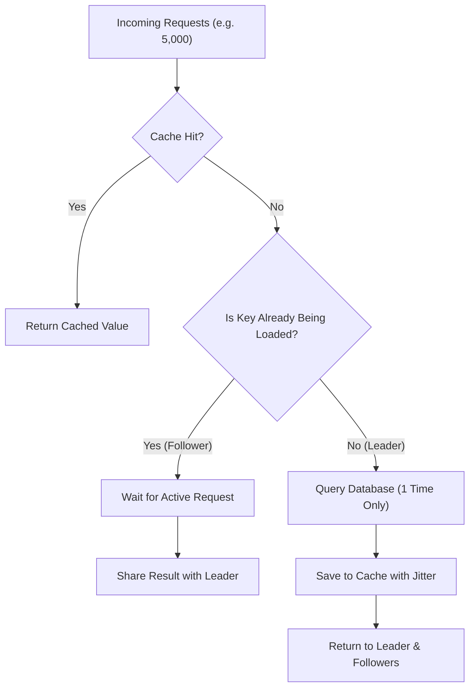

# GoCacheShield

[](https://golang.org)
[](LICENSE)
[](#quick-start)

> **Stop database overload from cache misses. Merges duplicate queries (Cache Stampede / Thundering Herd defense), limits parallel database hits, and adds random TTL jitter. Works with Go, Node.js, NestJS, PHP, and Laravel.**

---

## ⚡ The Problem: Cache Stampede

When a popular cache key expires (for example, `/products/trending`):
1. **5,000 requests arrive at the same second.**
2. All 5,000 requests see a cache miss.
3. All 5,000 requests query the database at the exact same millisecond.
4. Database CPU hits 100% and crashes.

**GoCacheShield fixes this:**
- **Request Coalescing (Singleflight):** Only **1 request** hits the database. The other 4,999 wait and share the single result.
- **Bulkhead Limiter:** Caps total concurrent database queries so the database never gets overwhelmed.
- **TTL Jitter:** Adds a small random time offset so thousands of keys don't expire at the same second.
- **Negative Caching:** Caches missing 404 items for a short time to prevent database scraping.

---

## 🚀 Quick Start

### In Go
```go
package main

import (
    "context"
    "fmt"
    "time"
    "github.com/Zihad-Bepari/GoCacheShield"
)

func main() {
    engine := gocacheshield.NewEngine(
        gocacheshield.WithMaxConcurrentLoads(50),
        gocacheshield.WithJitter(0.10), // +/- 10% TTL jitter
    )

    ctx := context.Background()

    // 100 concurrent callers for "product:1" will execute this loader ONLY ONCE
    data, err := engine.GetOrLoadRaw(ctx, "product:1", 60*time.Second, func(execCtx context.Context) ([]byte, error) {
        fmt.Println("Querying Database...")
        return []byte(`{"id": 1, "name": "Laptop"}`), nil
    })

    fmt.Println(string(data), err)
}
```

### In Node.js (Express)
```javascript
const express = require('express');
const { cacheShieldMiddleware } = require('gocacheshield');

const app = express();

// Protects all GET routes with automatic caching and stampede defense (TTL: 60s)
app.use(cacheShieldMiddleware({ ttl: 60 }));

app.get('/api/products/:id', (req, res) => {
  res.json({ id: req.params.id, name: 'Phone' });
});

app.listen(3000);
```

### In NestJS
```typescript
import { Controller, Get, UseInterceptors } from '@nestjs/common';
import { CacheShieldInterceptor, CacheShield } from 'gocacheshield';

@Controller('products')
@UseInterceptors(new CacheShieldInterceptor(new CacheShield(), { ttl: 60 }))
export class ProductController {
  @Get()
  getProducts() {
    return [{ id: 1, name: 'Laptop' }];
  }
}
```

### In Laravel
In controller or repository:
```php
use GoCacheShield\Laravel\Facades\CacheShield;

class ProductController extends Controller
{
    public function show($id)
    {
        // 500 parallel users will trigger DB find() exactly ONCE
        return CacheShield::getOrLoad("product:{$id}", 300, function () use ($id) {
            return Product::findOrFail($id);
        });
    }
}
```

---

## 📐 How It Works



---

## 📖 Full Documentation

For full setup guides, Redis integration, and configuration tables:
👉 **[Read the complete Project Setup Guide (PROJECT-SETUP.md)](PROJECT-SETUP.md)**

---

## 📄 License

MIT License — Copyright (c) 2026 Zihad Bepari.
